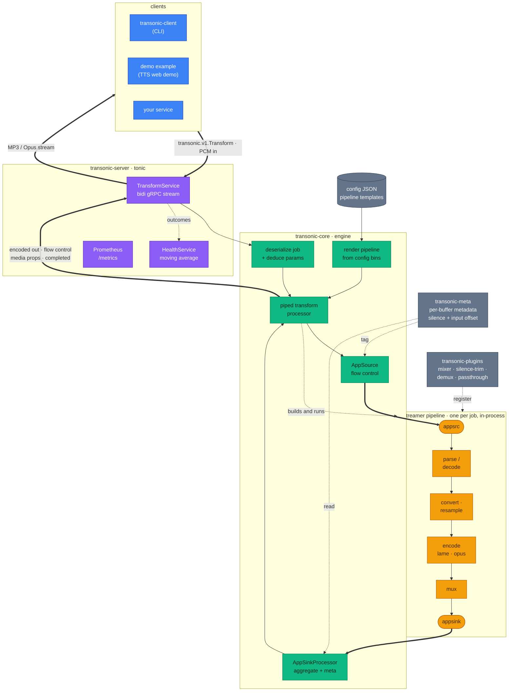

# Transonic

Transonic is a library and gRPC-based service for running GStreamer media
transformation pipelines as a service.  The name blends *transform*, *tonic*
(the gRPC stack it is built on) and *sonic*.

Clients pick a preconfigured pipeline and stream media through a bidirectional
gRPC call; the service renders the pipeline, transcodes the stream, applies
flow control, and streams the encoded result back.  The wire protocol
(`transonic.v1`), the JSON configuration schema, the pipeline template
language, the flow-control semantics and the command-line surface are all
stable.

## Architecture



Request path (top → bottom): a client opens a `Transform` bidi stream and
sends `TransformConfig` then PCM `InputChannelPayload`s; the engine deduces
the job parameters, renders the pipeline from the configured bins, and feeds
the bytes into `appsrc`.  Response path (bottom → top): `appsink` output is
aggregated into `OutputChannelPayload`s and streamed back, interleaved with
`FlowControlNotification` (NEED/ENOUGH_DATA), `MediaProperties` and a final
`TransformCompleted`.  Everything runs in-process — no subprocess, one
GStreamer pipeline per job.

Crates:

| Crate                | Purpose                                                                    |
| -------------------- | -------------------------------------------------------------------------- |
| `transonic-proto`    | Generated `transonic.v1` + `grpc.health.v1` protobuf/gRPC types.           |
| `transonic-meta`     | The per-buffer custom audio meta (silence flag, input stream offset).      |
| `transonic-core`     | Config loading, pipeline templates, jobs and the pipeline engine.          |
| `transonic-plugins`  | Custom GStreamer elements (see below), loadable statically or as a cdylib. |
| `transonic-server`   | The `transonic` service binary: gRPC server, health service, metrics.      |
| `transonic-client`   | The `transonic-client` CLI, plus the `demo`, `loadtest` and `backpressure` examples. |

Examples (under `crates/transonic-client/examples/`):

| Example        | Purpose                                                                       |
| -------------- | ----------------------------------------------------------------------------- |
| `demo`         | TTS streaming web demo (PCM in, MP3/WebM-Opus out; MSE playback).             |
| `loadtest`     | In-process concurrency load test (aggregate throughput, latency percentiles). |
| `backpressure` | Observes appsrc flow control (ENOUGH_DATA / NEED_DATA) under overload.         |

## Custom elements

| Element                        | Notes                                                        |
| ------------------------------ | ------------------------------------------------------------ |
| `backgroundaudiomixer`         | Background track mixing with volume / fade-in / fade-out.    |
| `startsilencecutter`           | RMS-based leading-silence detection and trimming.            |
| `smartvadstartsilencetrimmer`  | VAD-based variant; ships an energy VAD (see `transonic-plugins/src/vad.rs`). |
| `demuxtomultichannel`          | Interleaved multichannel → many mono streams.                |
| `passthroughdecoder`           | Transitional passthrough "decoder" + typefinder.             |

## Building

System dependencies (Debian/Ubuntu):

```sh
scripts/install-build-dependencies.sh    # gstreamer dev headers, protoc
scripts/install-runtime-dependencies.sh  # codec plugin packs for runtime
cargo build --release
```

Or build the container image (bundles all runtime codecs):

```sh
docker build -t transonic .
```

## Running

```sh
# Options (environment variables in parentheses):
#   TRANSONIC_CONFIG_PATH, TRANSONIC_ENDPOINT, TRANSONIC_LOG_LEVEL,
#   TRANSONIC_TEMP_STORAGE_DIRECTORY, TRANSONIC_SHUTDOWN_DELAY_SEC,
#   PROMETHEUS_PORT, PROMETHEUS_METRICS_PREFIX
transonic -c config/service_config_sample.json 0.0.0.0:5000
```

Transform a file with the CLI client:

```sh
transonic-client -p multi_any_audio/single_format_audio \
    -I multi_any -O riff-16khz-16bit-mono-pcm \
    -i input.mp3 -o output.wav \
    http://127.0.0.1:5000
```

Prometheus metrics are exposed at `http://0.0.0.0:8080/metrics`, and the
standard `grpc.health.v1.Health/Check` method reports the service health
(driven by a moving-average filter over transform outcomes).

### Monitoring stack (Prometheus + Grafana)

`deploy/` ships a ready-to-run Prometheus scrape config and a provisioned
Grafana dashboard.  With the service exposing metrics on `127.0.0.1:18330`:

```sh
# Prometheus — scrapes the service (shares the host network to reach it)
docker run -d --name transonic-prom --network host \
  -v "$PWD/deploy/prometheus.yml:/etc/prometheus/prometheus.yml" \
  prom/prometheus

# Grafana — Prometheus datasource + the "Transonic" dashboard, auto-provisioned
docker run -d --name transonic-grafana --network host \
  -e GF_AUTH_ANONYMOUS_ENABLED=true -e GF_AUTH_ANONYMOUS_ORG_ROLE=Admin \
  -v "$PWD/deploy/grafana/provisioning:/etc/grafana/provisioning" \
  -v "$PWD/deploy/grafana/dashboards:/etc/grafana/dashboards" \
  grafana/grafana
```

Then open Grafana at `http://localhost:3000` → dashboard **Transonic**
(active jobs, transcodes completed, throughput ops/s, error ratio, and
throughput-by-outcome / concurrency time series).

## TTS streaming demo

A web demo simulating the TTS scenario — a producer emits raw PCM (from
`testdata/`, in 20 ms chunks, optionally paced at 1× realtime like a live
TTS engine), Transonic transcodes it to MP3 or WebM/Opus at a selectable
sample rate and bitrate, and the browser plays the chunked stream while it
is still being generated:

```sh
# Terminal 1: the transform service with the TTS pipeline set
transonic -c config/tts_demo.json 127.0.0.1:15330

# Terminal 2: the demo web server (a client example)
cargo run --release --example demo -- \
    --listen 127.0.0.1:8093 --transform http://127.0.0.1:15330 --data testdata
# then open http://127.0.0.1:8093
```

Inputs cover s16le/f32le PCM at 8/16/24/48 kHz (`pcm_s16_*` / `pcm_f32_*`
bins); outputs cover MP3 at 16/24/44.1 kHz and WebM/Opus at 16/24/48 kHz,
with the bitrate supplied per request through the
`$(pipeline_parameters.bitrate,...)` template placeholder.

## Configuration

Configuration files are JSON documents matching the
`transonic.v1.ServiceConfiguration` schema (see
`config/service_config_sample.json`, `config/dev_env.json` and
`config/tts_demo.json`).  Pipeline bins are `gst-launch`-style fragments with
`$(pipeline_parameters.key,default)` placeholders substituted per channel at
request time.

## Tests

```sh
cargo test --workspace
```

The test suite covers:

* unit tests for the pipeline template language, configuration validation,
  job validation, the VAD and the health moving-average filter;
* engine integration tests (`transonic-core/tests/engine.rs`) covering
  passthrough, concat, file-sink draining, flow control and the error
  taxonomy — the counterpart of `test/piped_transform.cpp`;
* element tests (`transonic-plugins/tests/elements.rs`) — the counterpart of
  the `*Tests.cpp` plugin suites;
* end-to-end gRPC tests (`transonic-server/tests/grpc.rs`) — the counterpart
  of `test/grpc.cpp`.

Integration tests require a GStreamer installation (core elements are
sufficient for most of them).
